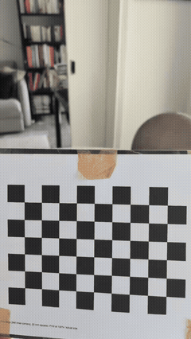
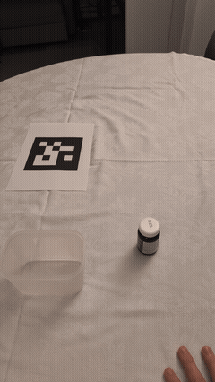
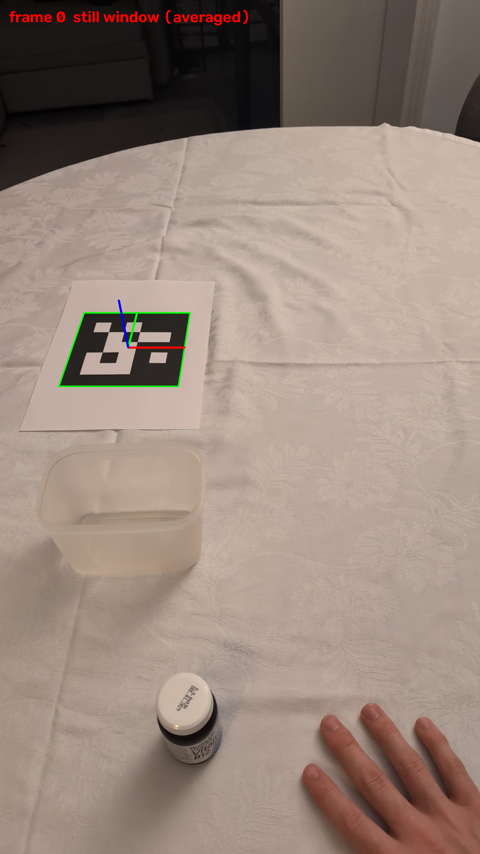
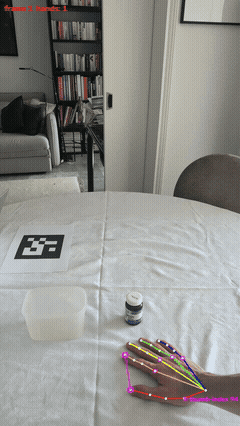
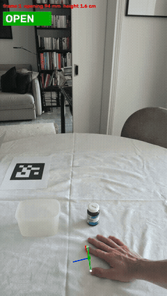
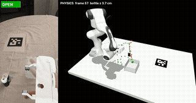

# Humanoid challenge

## Setup

Tested setup: Ubuntu-like Linux, x86_64, NVIDIA driver recent enough for CUDA 12.8
(`nvidia-smi` shows "CUDA Version: 12.8" or higher, i.e. driver 570+). Hand tracking
(below) uses the GPU automatically if there is one; rendering is headless (MuJoCo uses
EGL when there is no display).

**1. Get the project**: clone this repository.

**2. System packages** (Ubuntu / Debian; the libraries by OpenCV and by MuJoCo's
headless rendering, and FFmpeg's shared libraries (version 4 to 7) by torchcodec,
which decodes the videos of the LeRobot datasets used by `resfit/`):

```sh
sudo apt update && sudo apt install -y curl libgl1 libglib2.0-0 libegl1 ffmpeg
```

**3. Install uv** (it also installs Python 3.12 by itself):

```sh
curl -LsSf https://astral.sh/uv/install.sh | sh
source $HOME/.local/bin/env        # or open a new terminal
```

**4. Create the environment**, from the project folder:

```sh
cd Humanoid_challenge
uv sync
```

**5. Download the Panda model**: the evaluation env needs the Franka Panda mesh
assets in `sim/third_party/` (the full pipeline below would also fetch them on its
own first run, but this gets it out of the way upfront):

```sh
uv run python -c "import sys; sys.path.insert(0, 'sim'); from build_scene import ensure_panda; ensure_panda()"
```

This sparse-clones only the `franka_emika_panda/` folder from
[mujoco_menagerie](https://github.com/google-deepmind/mujoco_menagerie); the
download is ~10 MB.

## Recording your own demonstrations

Everything below starts from one raw egocentric video per recording session, placed
in `videos/task/dataset/` (the folder is not in git: there is nothing there until you
record and drop a video in). To produce one:

1. Print the fiducial tag (`tag/tag_5x5_id0_150mm.png`, already sized to 150 mm) and
   place it flat on the table in view of the camera: it is how the pipeline later
   recovers the camera/table pose for each episode.
2. Calibrate your phone's camera: print `tag/checkerboard_10x7_20mm_A4.pdf`, then
   film it with that phone for at least some tens of seconds while continuously moving it around,
   varying its position in frame, its distance from the camera, and its tilt/angle.
   `calibrate_camera.py` automatically picks a diverse subset of frames from the video
   (different positions, distances and tilts) to solve for the lens's focal length and
   distortion; a video where the board barely moves does not give it enough different
   viewpoints to calibrate accurately. The calibration itself is Zhang's method
   (OpenCV's `calibrateCamera`): it fits the pinhole camera model (intrinsic matrix and
   lens distortion) to the checkerboard corners seen in all those frames. Then:
   `uv run calibration/calibrate_camera.py <that video>`.

   <p align="center"></p>
3. Record one continuous egocentric video of as many pick-and-place demonstrations as
   you want, back to back, resetting the bottle and container between each. Start and
   end every single demonstration with about 1 s completely still, tag visible and
   hand flat on the table: the tag-pose and hand-tracking steps of the pipeline rely
   on that still moment to calibrate against.

   <p align="center"></p>
4. Save the video into `videos/task/dataset/`.

Then use the episode cutter below to split it into individual episode clips.

## Episode cutter (video_editing)

Takes one long egocentric recording (multiple demonstration episodes back to back,
with a reset in between each) from `videos/task/` and cuts it into individual
per-episode clips in `videos/task/dataset/`.

```sh
uv run video_editing/server.py
```

A local dashboard opens at http://localhost:8765 (use Chrome or Safari). Mark each episode's start/end in the
timeline, then export. 

## From episode videos to a robomimic dataset (pipeline)

```sh
uv run pipeline/run_dataset.py
```

The first run downloads the WiLoR weights (~2.6 GB, into
`hand_tracking/pretrained_models/`) and the Panda model (into `sim/third_party/`). 

WiLoR-mini downloads the MANO
hand model from a third-party mirror; MANO is licensed for non-commercial research
(registration at mano.is.tue.mpg.de).

For every clip in `videos/task/dataset/`, this turns the raw egocentric recording of a
human demonstration into a simulated robot trajectory, by running:

1. **Tag pose**: in the real video's first still frame, locate the fiducial marker
   printed on the table to recover the phone camera's pose relative to it. This real-
   world camera/table pose is what the simulated scene (step 5) is then built to match.

   <p align="center"></p>
2. **Hand tracking (WiLoR)**: track the hand's 3D pose and finger articulation frame
   by frame from the video alone.

   <p align="center"></p>
3. **Virtual gripper**: turn the tracked hand into an equivalent parallel-jaw gripper
   pose and open/close state (humans don't have a gripper, so this is a mapping, not
   a direct reading).

   <p align="center"></p>
4. **Depth correction**: the monocular hand pose is depth-ambiguous; this corrects it
   using the known table plane and object contact.
5. **MuJoCo scene**: build the simulated scene for this episode (table, Panda arm,
   tag, phone camera, bottle, container) placed consistently with the tracked poses.
6. **IK**: solve inverse kinematics so the simulated Panda arm's end-effector follows
   the virtual gripper's tracked trajectory.
7. **Physics rollout**: actually simulate the resulting joint trajectory in MuJoCo,
   producing the robot/object states and observations that become the dataset.

   <p align="center"></p>

Outputs in `videos/task/dataset_sim/`:

| Path | Content |
|---|---|
| `videos/<clip>.mp4` | real video with the simulated robot drawn over it, and a side view |
| `episodes/<clip>/` | all intermediate files, `demo.hdf5` (the recorded rollout), `log.txt` |
| `summary.csv` | one row per episode: status, failing step, success, key numbers |
| `robomimic/pick_place_bottle.hdf5` | the training dataset: successful episodes only |
| `robomimic/pick_place_bottle_episodes.csv` | which episodes were kept or excluded, and why |


**Dataset format** (robomimic HDF5, one `data/demo_i` per episode, recorded at 15 Hz):

- `actions` (N, 7): delta end-effector position (m) + rotation axis-angle (rad) +
  gripper (-1 open, +1 close). Also `actions_abs` (absolute end-effector target) and
  `actions_joint` (7 joint position targets + gripper, what the sim executed).
- `obs` / `next_obs`: `agentview_image` (128x128, fixed camera facing the robot),
  `robot0_eye_in_hand_image` (128x128, wrist camera), `robot0_joint_pos/_vel`,
  `robot0_eef_pos`, `robot0_eef_quat` (xyzw), `robot0_gripper_qpos/_qvel`,
  `object` (bottle position + quaternion, bottle relative to the gripper, container position).
- `rewards` (1 while the bottle is in the box), `dones`, `states` (MuJoCo
  `[time, qpos, qvel]`), and the scene XML in each demo's `model_file` attribute.
- `mask/train`, `mask/valid`: 90 / 10 split.

## Converting to the robot-base frame and LeRobot datasets

Each episode's scene is in its own tag frame (the robot base sits wherever that
episode's tag placed it), so the same arm pose has different coordinates in
different episodes. This step re-expresses every episode relative to the robot
base instead, then writes the LeRobot datasets `resfit/` trains on:

```sh
uv run resfit/pick_place/make_dataset.py
```

Every LeRobot dataset is named `<version>_<action mode>`. Each episode has
`observation.state` (end-effector position, quaternion xyzw, 2 finger joints - not
joint angles), `observation.images.agentview` and `observation.images.wrist`
(128 x 128 video), `action` and `next.done`, and ends at the demo's first success.

| Action mode | Size | Action |
|---|---|---|
| `absolute` | 7 | end-effector target: position, rotation axis-angle, gripper |
| `delta` | 7 | the same target relative to the current end-effector pose |
| `absolute_6d` | 10 | position, rotation as the first two rows of its matrix (continuous, unlike axis-angle), gripper |
| `joint` | 8 | the demo's recorded joint targets (7 arm joints) and gripper, executed without IK; `observation.state` is then the 7 arm joints and 2 fingers |

### Dataset versions

The command above writes both versions: `pick_place_bottle` (cut to 1 step after
success) and `pick_place_bottle_full` (cut to 8 steps after success - the most
`make_dataset.py` keeps).


## Training with ResFiT (resfit)

`resfit/` is a port of [ResFiT](https://github.com/amazon-science/residual-offpolicy-rl)
(residual off-policy RL on top of a behaviour-cloning policy) to this task, in PyTorch
with LeRobot. Its behaviour-cloning stage is ported: it trains a base policy on the
LeRobot datasets and evaluates it in the pick-and-place MuJoCo simulation
(`resfit/pick_place/env.py`), resetting from the recorded demos' own start states. The
residual RL stage is ported too (see Residual RL below).


At inference (left), the base policy predicts a chunk of actions once; a residual policy
then corrects each one individually as it's executed, using the current observation. Training
(right) has two phases: the base policy is behaviour-cloned on the offline demos (Phase 1,
this section); the residual policy is then trained by RL on top of it, frozen, using both
the offline demos and its own rollouts (Phase 2, see Residual RL below).

See [Converting to the robot-base frame and LeRobot datasets](#converting-to-the-robot-base-frame-and-lerobot-datasets)
above for the dataset formats and versions `resfit/` trains on.

### Training

```sh
# legacy_bc (plain BC: ResNet18 encoder + MLP head): 48 %
bash resfit/lerobot/shell/train_bc_legacy_bc_absolute_6d.sh

# flow_matching: 49 %, best result so far
bash resfit/lerobot/shell/train_bc_flow_matching_absolute_6d.sh

# smolvla: 32.8 %
bash resfit/lerobot/shell/train_bc_smolvla_joint_regularized.sh

# pi0: 23 %
bash resfit/lerobot/shell/train_bc_pi0_absolute_6d.sh
```

Main settings of these four runs (from their `.sh` files and LeRobot's default configs):

| | Unet flow matching | Plain BC | SmolVLA | π0 |
|---|---|---|---|---|
| Starting weights | from scratch | from scratch | pretrained (`lerobot/smolvla_base`) | pretrained (`lerobot/pi0`) |
| What's trained | everything | everything | everything, unfrozen (vision encoder + language model + action expert) | vision encoder frozen; language model + action expert fine-tuned |
| Vision | ResNet18, from scratch | ResNet18, from scratch | SmolVLM's vision encoder | PaliGemma's SigLIP encoder |
| Action head | 1D Unet, flow matching | MLP 256-256, MSE loss | action expert, flow matching | action expert, flow matching |
| Dataset | `pick_place_bottle_full` | `pick_place_bottle` | `pick_place_bottle_full` | `pick_place_bottle_full` |
| Camera | agentview only | agentview only | agentview only | agentview only |
| Observation frames | 2 | 2 | 1 | 1 |
| Action | absolute, 6D rotation | absolute, 6D rotation | joint angles | absolute, 6D rotation |
| Chunk predicted / executed | 16 / 8 | 16 / 8 | 50 / 10 | 16 / 16 |
| Batch size | 64 | 64 | 64 | 16 |
| Training steps | 100k | 100k | 4k | up to 100k |
| EMA of weights | yes | yes | yes | no |
| Success | **49 %** | 48 % | 32.8 % | 23 % |

| Policy (`POLICY`) | Model |
|---|---|
| `act` | ResFiT's ACT: ImageNet-pretrained ResNet18 (frozen batch norm), transformer |
| `mlp` | ACT's vision, an MLP predicting the whole chunk instead of the transformer |
| `diffusion` | Diffusion Policy: ResNet18 from scratch (GroupNorm, spatial softmax, random crop), 1D Unet, denoising |
| `unet_bc` | the same Unet and encoder trained by plain BC (MSE on the chunk, one pass) |
| `flow_matching` | the same Unet and encoder trained by flow matching (10 Euler steps to sample) |
| `legacy_bc` | plain BC: the same encoder, an MLP 256-256 head instead of the Unet (MSE on the chunk), images randomly cropped to 116 x 116 |
| `smolvla` | LeRobot's SmolVLA vision-language-action model (450M parameters, flow-matching action expert), one observation frame, the task sentence as instruction; `PRETRAINED=lerobot/smolvla_base` starts from the pretrained model (vision-language model and action expert both trained) |
| `pi0` | LeRobot's PI0 vision-language-action model (PaliGemma-3B backbone + flow-matching action expert), one observation frame, the task sentence as instruction; `PRETRAINED=lerobot/pi0` starts from the pretrained checkpoint (its own bf16 precision kept as released, not forced to fp32 like SmolVLA) |

| Setting | Default | Meaning |
|---|---|---|
| `DATASET`, `ACTION_MODE` | `pick_place_bottle`, `absolute` | which LeRobot dataset ([Dataset versions](#dataset-versions)) |
| `CAMERAS` | all | `"agentview wrist"`, `agentview` or `wrist` |
| `N_OBS_STEPS` (To) | the policy's own (ACT, MLP: 1; Diffusion Policy family: 2) | observation frames |
| `CHUNK_SIZE` (Ta) | 16 | actions predicted per call |
| `N_ACTION_STEPS` | 8 | execution horizon: actions executed per call |
| `NORMALIZER` | `mean_std` | `per_dim_range`: state and position actions mapped to [-1, 1] per dimension, quaternion / rotation / gripper unchanged |

Each run writes to `outputs/resfit_bc/<run name>/`: `latest/` (to resume), `best/` (the
best evaluation so far, with EMA its averaged weights: the policy the residual RL will
start from) and `evals/` (one video per evaluation, both cameras side by side).


### Evaluating a checkpoint

```sh
bash resfit/lerobot/shell/eval_bc.sh             # defaults: the SmolVLA unfrozen run's best/, demo layouts, on GPU 0
RUN=outputs/resfit_bc/<run name> N_ACTION_STEPS="8" bash resfit/lerobot/shell/eval_bc.sh
```

Evaluates a saved checkpoint without training, at several execution horizons, writing
videos and per-episode/per-horizon results to `<RUN>/evals_offline/`. Works for every
policy `train_bc.py` saves.

### Residual RL

```sh
bash resfit/rl_finetuning/shell/train_residual_td3.sh
```

ResFiT's residual TD3 (`resfit/rl_finetuning/scripts/train_residual_td3.py`): takes a
policy already trained above and fine-tunes it with RL, without changing its weights.
A small actor-critic learns a correction to add on top of each of its actions (capped
at `ACTION_SCALE`, a fraction of the action range), trained on a mix of the frozen
policy's own rollouts and the demos. Writes to `outputs/resfit_residual/<run name>/`.


